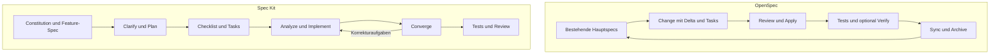

# OpenSpec vs. Spec Kit

**Zwei Wege von einer Idee zu überprüfbarer Software — mit unterschiedlichen Schwerpunkten, nicht mit einem universellen Sieger.**

OpenSpec organisiert **Änderungen an dauerhaft gepflegten System-Spezifikationen**. Spec Kit strukturiert **Feature-Arbeit von Anforderungen über Planung bis zur Umsetzung und Nachprüfung**. Beide machen Absicht, Entscheidungen und Aufgaben sichtbarer. Keines ersetzt gute Anforderungen, ausführbare Tests oder eine tatsächlich konfigurierte Merge-Sperre. [O1](sources.md#o1), [O2](sources.md#o2), [S1](sources.md#s1), [S2](sources.md#s2).

> **Kurzempfehlung:** Für ein bestehendes System mit laufenden, begrenzten Verhaltensänderungen zuerst OpenSpec prüfen. Für ein neues oder komplexes Feature mit vielen offenen Fragen und Bedarf an expliziter Plan-/Task-Konsistenz zuerst Spec Kit prüfen. Für einen trivialen Fix kann ein Ticket mit Regressionstest reichen. Das ist eine Aufwand-/Risikoregel, kein gemessener Produktivitätsvergleich.

**Stand:** 27.10.2026. Beide offiziellen Repository-HEADs wurden per Git ermittelt und Quellen am exakten Commit gelesen. **Keine Installation, keine Produktbenchmark-Ausführung.** [Quellen und Pins](sources.md) · [Tatsächlich ausgeführte Prüfungen](docs/verification.md)

## Eigener Entwurf: SDD-evo Framework

[SDD-evo](sdd-evo/README.md) ergänzt diesen Vergleich um unseren eigenen evidenzgebundenen Loop: autorisierter Auftrag → begrenzte Umsetzung → Gesamtintegration → versionsgebundene Abnahme → Reparatur, explizite Auftragsänderung oder Abschluss. Release und Framework-Evolution bleiben getrennte Schleifen.

Enthalten sind [Zustände und Flow](sdd-evo/FRAMEWORK.md), [Artefakte](sdd-evo/ARTIFACTS.md), [Dreiervergleich](sdd-evo/COMPARISON.md), [durchgängiges Beispiel](sdd-evo/EXAMPLE.md), [Evidenz](sdd-evo/EVIDENCE.md) und ein [ausgeführter Prüfprototyp](sdd-evo/docs/VERIFICATION.md). **Design und Konsistenzdemonstrator, keine produktionsfertige Runtime oder nachgewiesene Überlegenheit.**

## Die Matrix auf einen Blick

**Gut** = Vorteil unter der genannten Bedingung. **Bedingt** = Nutzen hängt von Arbeitsweise und Pflege ab. **Schlecht als …** = ungeeigneter Einsatz, nicht pauschal schlechtes Produkt. Bewertungen sind unsere Ableitung aus den verlinkten Mechanismen.

| Frage | OpenSpec | Spec Kit | Good / bad / conditional |
|---|---|---|---|
| Was ist das zentrale Modell? | Aktuelle Capability-Specs plus isolierte Change-Deltas und Archiv. [O2](sources.md#o2), [O10](sources.md#o10) | Constitution plus Feature-Spec, Plan, Tasks und ergänzende Designartefakte. [S1](sources.md#s1), [S9](sources.md#s9) | OpenSpec gut für fortlaufenden Systemzustand; Spec Kit gut für strukturierte Feature-Entstehung. |
| Wie komme ich ins Arbeiten? | explore → propose → Review → apply → sync/archive. [O1](sources.md#o1) | constitution → specify → clarify → plan → checklist → tasks → analyze → implement → converge. Kürzerer Pfad vorhanden. [S1](sources.md#s1) | Weniger sichtbare Schritte können bei kleinen Changes helfen; mehr Prüfpunkte können bei komplexen Features helfen. Kein Zeitbenchmark. |
| Was passiert bei einer Planänderung? | update gleicht vorhandene Planungsartefakte mit Bestätigung ab, nicht den Code. [O1](sources.md#o1) | Spec/Plan gezielt überarbeiten, Tasks und analyze nachziehen; converge ist dafür nicht zuständig. [S1](sources.md#s1), [S2](sources.md#s2) | Beide bedingt: geänderte Absicht explizit freigeben, nicht aus fehlerhaftem Code ableiten. |
| Wie wird Drift erkannt? | verify betrachtet Vollständigkeit, Korrektheit und Kohärenz; optionales Workflow-Set. [O5](sources.md#o5), [O11](sources.md#o11) | analyze liest Artefakte; converge prüft Code gegen Absicht und hängt Korrekturaufgaben an. [S3](sources.md#s3), [S2](sources.md#s2) | Gut als Review-Hilfe; schlecht als alleiniger Beweis, dass Verhalten korrekt ist. |
| Wird ein falscher Merge automatisch blockiert? | verify ist beratend; CLI-Validierung hat begrenzte strukturelle Sperren, kein allgemeines Verhaltenstor. [O4](sources.md#o4), [O7](sources.md#o7) | Core-Prompts sind keine Branch Protection; separate Workflow-Gates existieren. [S3](sources.md#s3), [S13](sources.md#s13), [S14](sources.md#s14) | Beide schlecht als Ersatz für unabhängige Tests + verpflichtende Statuschecks + Reviewer. |
| Was bedeutet „fertig“? | Archiviert kann trotz Warnungen oder ohne Sync sein. [O3](sources.md#o3) | Abgehakte Tasks oder „Converged“ sind Agentenbefunde, kein Testzertifikat. [S2](sources.md#s2) | Nur mit unabhängiger Abnahme gut. |
| Kleine Änderung im Bestand? | Change-Paket und Delta passen direkt zum Fall. [O2](sources.md#o2) | Kürzerer Pfad möglich; nicht ausschließlich Greenfield. [S1](sources.md#s1) | Tendenz OpenSpec, sofern das Team die Hauptspecs pflegt. |
| Neues, mehrdeutiges Feature? | Explore und schrittweise Artefakte möglich. [O1](sources.md#o1) | Eigene Clarify-, Checklist- und Analyze-Schritte. [S1](sources.md#s1) | Tendenz Spec Kit, wenn die zusätzlichen Reviews tatsächlich stattfinden. |
| Welches ist schneller oder günstiger? | Hier nicht gemessen. | Hier nicht gemessen. | Offen. Modell, Kontext, Review und Nacharbeit dominieren möglicherweise; keine Prozentversprechen. |

Die [ausführliche Vergleichsmatrix](docs/comparison-matrix.md) behandelt außerdem Setup, Integrationen, Anpassbarkeit, CI, Parallelität, Historie, Kosten und Adoption.

## So unterscheiden sich die Arbeitsmodelle



Das Diagramm ist eine empfohlene Lesereihenfolge, keine erzwungene Zustandsmaschine. Git-PR, CI und Freigabe liegen als eigene Kontrollschicht darüber. Ein Sync ist kein Code-Merge, ein Archiv kein Deployment und eine Checkbox kein bestandener Test.

## Lesepfade

- **Entscheidung treffen:** [Matrix](docs/comparison-matrix.md) → [Adoption, Aufwand und Grenzen](docs/adoption-and-cost.md).
- **OpenSpec verstehen:** [Artefakte, Schrittfolge, Kommandos und Fallstricke](docs/openspec.md).
- **Spec Kit verstehen:** [Schrittfolge, Feature-State und Converge](docs/spec-kit.md).
- **Drift wirklich kontrollieren:** [Prävention, Detektion und Enforcement](docs/drift-and-gates.md).
- **Beide am selben Fall vergleichen:** [Synthetischer Brain-Public-Export](docs/example-workflow.md) → [Anforderungs- und Testcheckliste](docs/requirements-and-tests.md).
- **Aussagen nachprüfen:** [Quellenregister inklusive Widersprüchen](sources.md) → [Verifikationsbericht](docs/verification.md).

## Was dieses Repository ist — und was nicht

Ein deutschsprachiges, quellengebundenes Entscheidungsdossier mit selbst geschriebenen Beispielen. Kein Fork, keine Herstellerdokumentation, keine fertige Export-Anwendung und kein Beleg für Überlegenheit eines Frameworks. Die Beispieltests sind Abnahmeanforderungen, nicht bereits implementierte Produkttests.

Die lokale Dokumentationsprüfung benötigt nur Python 3:

```bash
python3 scripts/check_docs.py
python3 scripts/check_docs.py --network
```

Der erste Aufruf ist offline und deterministisch. Der zweite prüft zusätzlich eine festgelegte Auswahl gepinnter öffentlicher Primärquellen über HTTPS. Keine Framework-Installation und kein Agentenaufruf. Reichweite und echte Resultate stehen in der [Verifikation](docs/verification.md).
