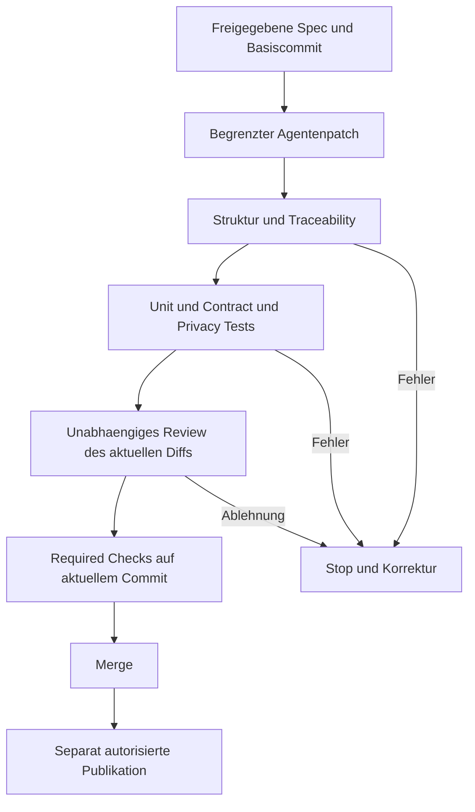

# Drift: vorbeugen, erkennen, tatsächlich stoppen

[Übersicht](../README.md) · [Beispiel](example-workflow.md)

**Drift** heißt hier: zwei Zustände, die zusammenpassen sollten, laufen auseinander. Mehr Markdown kann Drift sichtbar machen, aber auch neue Widersprüche erzeugen. Entscheidend ist, welche Quelle maßgeblich ist und wer eine Änderung freigibt.

## Drei Mechanismen, nicht ein Schlagwort

1. **Prävention:** klare Anforderungen, begrenzter Scope, Constitution/Regeln, Klärung vor Umsetzung. Reduziert Gelegenheiten für Fehler; garantiert nichts.
2. **Detektion:** Review, analyze/verify/converge, strukturierte Validierung, Anwendungstests. Liefert Befunde mit unterschiedlicher Aussagekraft.
3. **Enforcement:** ein außerhalb der beurteilten Agentenantwort liegender Mechanismus verweigert die nächste Wirkung: fehlgeschlagener Required Check, eingeschränkte Credentials, geschützter Branch oder verpflichtende unabhängige Freigabe. Ein Stoppsatz im Prompt ist nicht dieselbe Vertrauensgrenze.

Core-Prompts und echte CLI-Prüfungen existieren nebeneinander. Deshalb weder „automatisch alles abgesichert“ noch „beide bestehen nur aus Prompts“ behaupten. [O4](../sources.md#o4), [O5](../sources.md#o5), [S3](../sources.md#s3), [S5](../sources.md#s5), [S14](../sources.md#s14).

## Drift-Matrix

| Drift-Typ | Beispiel | Prävention | Detektion | Belastbare Durchsetzung |
|---|---|---|---|---|
| Absichtsdrift | „Nur public“ wird still zu „alles außer private“. | Positive Allowlist und explizite Negativfälle in Spec. | Review und Policy-Tests gegen unbekannte Labels. | Required Privacy-Test; Export-Credential ohne interne Leserechte. |
| Artefaktdrift | Spec verlangt JSON, Plan und Tasks sprechen CSV. | Eine Entscheidung einmal festhalten, Ableitungen verlinken. | OpenSpec update/verify bzw. Spec Kit analyze. | Eigener Konsistenzcheck für maschinenlesbare Verträge plus unabhängiges Review. |
| Implementierungsdrift | Filter existiert, übersieht aber fehlende Labels. | Kleine Tasks mit konkreter Abnahme. | verify bzw. converge; Unit-/Integrationstests. | Nicht bestandene Verhaltenstests blockieren Merge. |
| Umfangsdrift | Agent ergänzt Login-Export oder Telemetrie ohne Auftrag. | Non-goals und begrenzte Schreibfläche. | Diff-Review; converge `unrequested`; Netzwerkbeobachtung im Test. | Schreib-/Egress-Beschränkung und Freigabe für Scope-Erweiterung. |
| Testdrift | Test passt sich dem falschen Code an. | Abnahmekriterien vor Umsetzung freigeben. | Review von Teständerungen, unveränderte Holdout-Fälle. | Agent darf geschützte Abnahmesuite nicht selbst abschwächen. |
| Basisdrift | Zwei Changes ersetzen dieselbe Hauptanforderung. | Frische Basis, klare Ownership, kleine PRs. | Spec-Diff und Integrationstest nach Zusammenführung. | Aktualität des Merge-Commits prüfen, Änderungen erneut testen. |
| Kontextdrift | Spec-Kit-Befehl arbeitet nach Branchwechsel am alten Feature. | Feature-Pfad explizit je Prozess/Worktree setzen. | Pfad-Readback vor Schreiboperation. | Runner verweigert Pfad außerhalb erlaubtem Feature. |
| Versionsdrift | Doku beschreibt neuen Skill, installiert ist älterer Prompt. | CLI-, Schema-, Adapter- und Promptstände erfassen. | Installierte Dateien mit erwarteten Ständen vergleichen. | Geprüfte Versionen im Runner; kontrollierter Upgrade-PR. |
| Betriebsdrift | Bereits exportierter Artikel wird später nichtöffentlich. | Widerrufs-/Rebuild-Vertrag und Zuständigkeit. | Regelmäßiger Abgleich Publikationsmanifest gegen aktuelle Freigabe. | Neuveröffentlichung stoppt; Removal-/Purge-Prozess mit überprüftem Ergebnis. |

Zuordnung der Produktmechanismen: [O1](../sources.md#o1), [O5](../sources.md#o5), [S2](../sources.md#s2), [S3](../sources.md#s3), [S6](../sources.md#s6), [S8](../sources.md#s8). Die Enforcement-Spalte ist **unsere zusätzliche Architektur**, kein behaupteter Standardumfang der Produkte.

## Welche Prüfung sagt tatsächlich was aus?

| Signal | Was es aussagt | Was es nicht aussagt |
|---|---|---|
| Datei vorhanden / Schema-Abhängigkeit erfüllt | Ein erforderliches Artefakt ist auffindbar. | Dass der Inhalt richtig oder vollständig ist. |
| OpenSpec validate erfolgreich | Geprüfte Struktur-/Delta-Regeln wurden erfüllt. | Dass Anwendungscode das Verhalten erfüllt. |
| Alle Tasks abgehakt | Fortschritt wurde so markiert. | Dass Tests liefen oder freigegebene Abnahme bestanden ist. |
| Spec Kit Custom-Checklist vollständig | Reviewer hat Requirements-Qualität bestätigt. | Dass Implementierung fertig ist. |
| analyze / verify ohne Befund | Agent hat innerhalb seines Kontexts keinen Befund gemeldet. | Dass kein Fehler existiert oder alle relevanten Pfade gesehen wurden. |
| Converged | Agent meldet keine weitere umsetzbare Lücke zur gelesenen Absicht. | Formale Korrektheit, vollständige Tests oder autonome Merge-Erlaubnis. |
| Anwendungstests grün | Konkrete Assertions bestanden gegen konkreten Stand. | Dass alle möglichen Eingaben/Umgebungen abgesichert sind. |
| Required Checks + Review auf aktuellem Commit | Konfigurierte Merge-Voraussetzungen erfüllt. | Produktionssicherheit jenseits der geprüften Annahmen. |

Quellen für Produktgrenzen: [O3](../sources.md#o3), [O4](../sources.md#o4), [O5](../sources.md#o5), [O7](../sources.md#o7), [S2](../sources.md#s2), [S3](../sources.md#s3), [S4](../sources.md#s4), [S5](../sources.md#s5).

## Konkrete Gate-Kette für einen späteren Pilot

**Empfohlene, hier nicht eingerichtete Policy:**

- CI führt deterministische Tests aus, nicht bloß einen Agentenbericht. Fehlende Tests oder übersprungene Jobs zählen nicht als Erfolg.
- Branch-Regeln verlangen die richtigen Statuschecks und unabhängige Review-Freigabe. Agenten-Credentials dürfen weder Regeln ändern noch Bypass-Rechte besitzen.
- Spec-/Test-/CI-Änderungen sind sichtbarer Teil des Reviews. Ein Agent darf die Abnahme nicht selbst neu definieren, um einen Patch grün zu machen.
- OpenSpec-Archive nur nach bestandener Team-Abnahme; `--yes` und `--no-validate` nicht als CI-Abkürzung verwenden. `validate --archived` separat erwägen.
- Spec Kit: Analyze-/Converge-Berichte sind zusätzliche Evidenz; bei offenen Findings keine Freigabe durch Texttricks. Separate Workflow-Gates bewusst konfigurieren, wenn sie benutzt werden.
- Merge und Publikation bleiben getrennt. Export-Credentials nicht dem Implementierungsagenten geben. Kein privater Datensatz in Testlogs.

**Dieses Dokumentationsrepository richtet keine Produkt-CI oder Branch Protection ein.** Sein lokaler Checker prüft nur dieses Dossier, nicht den Export-Service und nicht eine der beiden Framework-Installationen. Siehe [Verifikation](verification.md).

## Verbesserung ohne selbst erteilte Freigabe

Wiederholter Fehler → unveränderte Evidenz sichern → Ursache eingrenzen → kleine Regel-/Skill-/Umgebungsänderung → gegen unveränderte Baseline und Abnahme testen → bewusst übernehmen oder verwerfen → versionierter Rollout mit Rückweg. Nicht jeder Einzelfehler rechtfertigt eine neue immer geladene Instruktion. Budget, Autorisierung und Akzeptanztests liegen außerhalb der durch den Agenten optimierten Fläche. Das ist eine vorgeschlagene Betriebsdisziplin, kein Benchmarkresultat dieser Werkzeuge.
