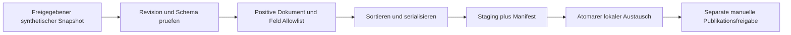

# Derselbe Fall: ein sicherer Brain-Public-Export

[Übersicht](../README.md) · [Abnahmecheckliste](requirements-and-tests.md)

**Rein synthetisches Designbeispiel.** „Brain“ bezeichnet hier eine generische Wissenssammlung, kein konkretes produktives System. Keine realen Dokumente, internen Endpunkte, Provider-IDs, Zugangsdaten oder Betriebsartefakte wurden verwendet. Die nachfolgenden Daten sind ausdrücklich erfunden und nicht als abgerufene Ergebnisse dargestellt.

## Auftrag und Annahmen

Eine Redaktion möchte bereits freigegebene öffentliche Artikel als JSON-Datei ausliefern. Es gibt eine vertrauenswürdige Snapshot-Schnittstelle, die Freigabestatus pro Dokument liefert. Implementierungsagenten arbeiten ausschließlich mit synthetischen Fixtures. Publikation ist ein separater menschlich autorisierter Schritt.

**In Scope:** deterministischer Export eines unveränderlichen Snapshots, positive Dokument-/Feld-Allowlist, Ablehnung bei unklarer Freigabe, minimales Manifest, atomare lokale Bereitstellung. **Nicht in Scope:** Inhalte veröffentlichen, Datenschutzlabel ändern, private Inhalte „anonymisieren“, externe Links nachladen, vollständige Brain-Backups oder Uploads in echte Systeme.

Synthetische Eingabe:

```json
[
  {"id":"demo-public-1","visibility":"public","approved":true,"title":"Was ist ein Index?","body":"Ein öffentlicher Beispieltext.","internal_note":"Nicht exportieren"},
  {"id":"demo-hidden-1","visibility":"internal","approved":true,"title":"Testdatensatz","body":"Synthetischer Ausschlussfall"}
]
```

Erwarteter Dokumentanteil im Export, **kein ausgeführtes Ergebnis**:

```json
[{"id":"demo-public-1","title":"Was ist ein Index?","body":"Ein öffentlicher Beispieltext."}]
```

## Gemeinsame, vor Implementierung freizugebende Anforderungen

| ID | Muss-Verhalten | Abnahmefall |
|---|---|---|
| FR-001 | Nur `visibility == public` und `approved == true` sind exportierbar. | Öffentlicher freigegebener Artikel vorhanden; alle übrigen Kombinationen ausgeschlossen. |
| FR-002 | Fehlendes, unbekanntes oder falsch typisiertes Freigabefeld macht den gesamten Lauf ungültig. | Kein neues Ausgabeartefakt; eindeutiger Fehlerstatus. |
| FR-003 | Exportiert werden ausschließlich id, title und body. | Zusätzliche Eingabefelder gelangen nicht in Ausgabe oder Logs. |
| FR-004 | Artikel werden nach id sortiert; gleiche Snapshot-Eingabe erzeugt identische UTF-8-Bytes. | Wiederholung und permutierte Eingabereihenfolge ergeben gleiche Bytes. |
| FR-005 | Duplikate, ungültige Pflichtfelder und unerlaubte Referenzen stoppen den Lauf. | Kein stilles Zusammenführen; keine internen Linkziele im Output. |
| FR-006 | Der Export arbeitet gegen einen konsistenten Snapshot; ein vorgeschalteter Adapter bestätigt die erwartete Revision. | Revisionskonflikt stoppt vor Bereitstellung. |
| FR-007 | Die vorherige gültige Ausgabe bleibt bei Fehler erhalten; neue Ausgabe wird atomar ersetzt. | Fehler während Serialisierung/Schreiben hinterlässt keine halbe Veröffentlichung. |
| FR-008 | Manifest nennt Formatversion, freigegebene Revision, Artikelanzahl und Inhaltsdigest; keine internen Details. | Manifest stimmt mit Bytes überein; keine Titel ausgeschlossener Dokumente. |
| FR-009 | Kein Netzwerkzugriff des Export-Kerns; Publikation erfolgt separat. | Test-Sandbox verweigert Netzwerk; keine Upload-Routine im Kern. |
| FR-010 | Ein Widerruf verhindert die nächste Veröffentlichung und löst einen gesonderten Removal-Prozess aus. | Neuer Snapshot ohne Freigabe enthält Artikel nicht; alte öffentliche Kopie wird nicht fälschlich als entfernt behauptet. |

**Wichtige fachliche Grenze:** Ein Label alleine beweist keine inhaltliche Veröffentlichbarkeit. Die Redaktion muss Inhalt, eingebettete Referenzen und Freigabe vor dem Snapshot prüfen. Bereits öffentlich kopierte Daten lassen sich durch Rebuild nicht zuverlässig zurückholen. FR-010 verlangt deshalb einen eigenen, überprüfbaren Widerrufsprozess statt eines Löschversprechens.

## Variante A: OpenSpec

1. `/opsx:explore public-export`: Fail-closed, Revision, Feld-Allowlist und Widerruf klären.
2. `/opsx:propose add-public-export`: Proposal mit Scope und Risiko; neue Capability `public-export`; Delta mit den Anforderungen oben; Design für Snapshot → Policy → Serializer → Staging → Manifest.
3. Review vor Code. Bei fehlendem FR-002 `/opsx:update add-public-export`; Zustimmung zur Artefaktänderung, danach Tasks prüfen.
4. `/opsx:apply add-public-export`: Tests und Code je Gruppe. Hier nur Anleitung, keine Ausführung.
5. Strukturprüfung und echte Produkttests; optional aktiviertes `/opsx:verify add-public-export` zusätzlich.
6. `/opsx:sync add-public-export`: Delta zu Hauptspec; Diff auf verlorene Anforderungen und Szenarien prüfen.
7. `/opsx:archive add-public-export`: Warnungen/Sync-Status lesen, dann PR-Abnahme. Nicht unmittelbar publizieren.

Quellen für die Workflow-Zuordnung: [O1](../sources.md#o1), [O2](../sources.md#o2), [O3](../sources.md#o3), [O5](../sources.md#o5).

Selbst formulierter Ausschnitt einer **neuen** Delta-Spec; bewusst nur FR-001, nicht die vollständige Capability:

```markdown
## Purpose
Dieser Export stellt ausschließlich redaktionell freigegebene öffentliche Wissensartikel bereit.

## ADDED Requirements

### Requirement: FR-001 Positive Freigabe
Das System MUST ausschließlich Artikel mit visibility public und approved true exportieren.

#### Scenario: Freigegebener öffentlicher Artikel
- **WHEN** der Snapshot einen gültigen öffentlichen, freigegebenen Artikel enthält
- **THEN** enthält die Ausgabe genau dessen erlaubte Felder

#### Scenario: Nichtöffentlicher Artikel
- **WHEN** ein gültiger Artikel als internal gekennzeichnet ist
- **THEN** fehlt dieser Artikel vollständig in der Ausgabe
```

Bei einer **späteren Verhaltensänderung** an dieser bestehenden Capability: MODIFIED mit vollständigem betroffenen Requirement und erhaltenen Szenarien; neue unabhängige Anforderung ADDED. Nicht alle alten Szenarien durch einen Halbsatz ersetzen. [O2](../sources.md#o2).

## Variante B: Spec Kit

1. `/speckit-constitution`: Public-only, Testpflicht, begrenzte Rechte, unabhängige Publikationsfreigabe.
2. `/speckit-specify`: Stories „Öffentlichen Snapshot exportieren“ und „Unsicheren Export verhindern“ mit FR-001 bis FR-010.
3. `/speckit-clarify`: Ist unbekanntes Label Ausschluss oder Laufabbruch? Hier verbindlich Laufabbruch. Was heißt Widerruf bei bereits verteilten Kopien?
4. `/speckit-plan`: Datenmodell und Vertrag, deterministische Serialisierung, atomarer Austausch, Risiken und Rollback.
5. `/speckit-checklist`: Reviewer prüft messbare Anforderungen und klare Fehlersemantik, nicht ob Code bereits fertig ist.
6. `/speckit-tasks`: FR-/Story-Bezug und konkrete Testaufgaben ausdrücklich verlangen; Testpflicht nicht aus Toolnamen ableiten.
7. `/speckit-analyze`: Prüfen, ob jede buildbare Verpflichtung in Plan/Tasks vorkommt; Widersprüche im jeweiligen Quellartefakt korrigieren.
8. `/speckit-implement`: Umsetzung und echte Testresultate.
9. `/speckit-converge`: aktuellen Code gegen unveränderte Absicht prüfen. Nach Korrektur-Tasks wieder implement und erneut converge; dann unabhängige Abnahme.

Quellen für diese Zuordnung: [S1](../sources.md#s1), [S2](../sources.md#s2), [S3](../sources.md#s3), [S4](../sources.md#s4), [S10](../sources.md#s10).

Selbst formulierter Task-Ausschnitt, **keine generierte Ausgabe**:

```markdown
- [ ] T001 [US1] Policy-Tests für FR-001 bis FR-003 in tests/test_policy.py schreiben und Negativfälle prüfen
- [ ] T002 [US1] Policy in src/export_policy.py implementieren; Policy-Suite ausführen
- [ ] T003 [US1] Determinismus und Konfliktfälle FR-004 bis FR-006 in tests/test_snapshot.py prüfen
- [ ] T004 [US1] Atomaren Dateiaustausch und Manifest FR-007/FR-008 implementieren; Fehler-Injektion testen
- [ ] T005 [US2] Netzwerk- und Publikationsgrenze FR-009/FR-010 separat reviewen und testen
```

## Gleicher Fehler, andere Korrekturschleife

Angenommener, nicht beobachteter Bug: Der Code exportiert alles, was **nicht** `internal` ist. Das lässt unbekannte Labels durch.

| Ebene | OpenSpec | Spec Kit | Gleiche unabhängige Abnahme |
|---|---|---|---|
| Befund | verify kann die Abweichung zur Requirement markieren. | converge kann `contradicts` gegen FR-001/FR-002 melden. | Negativtest unbekanntes Label muss fehlschlagen. |
| Korrektur | Task ergänzen bzw. korrigieren; apply. Nicht Spec passend zum Bug abschwächen. | Neue Convergence-Task anhängen; implement. Spec und Plan bleiben durch converge unverändert. | Implementierung auf positive Freigabe und Fail-closed korrigieren. |
| Abschluss | Verify, Tests, Sync-Diff und Archive-Readback. | Converge, Tests und Artefakt-Review. | Required Tests und Reviewer auf aktuellem Commit; separate Publikationsfreigabe. |

Mechanismen: [O5](../sources.md#o5), [S2](../sources.md#s2). Ein Agent kann den Fehler übersehen; der vorab definierte Test darf deshalb nicht von seiner Bewertung abhängen.

## Minimaler Datenfluss und Rückweg



Der Export-Kern benötigt keine Produktions-Credentials. Bei Fehler bleibt die letzte gültige lokale Ausgabe bestehen; bei Privacy-Verdacht wird **Publikation gestoppt**, nicht die letzte Ausgabe ungeprüft erneut verteilt. Widerruf/Purge, Cache und externe Kopien sind getrennte Zustände. Das Dossier liefert diesen Entwurf und die Abnahmeanforderungen, **keine implementierte Exportsoftware**.
