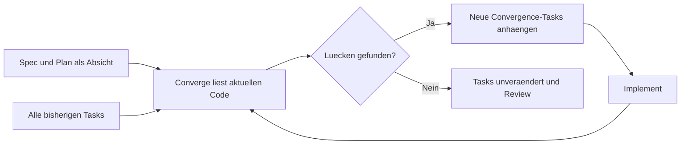

# Spec Kit: Absicht, Plan, Tasks und Convergence

[Übersicht](../README.md) · [Matrix](comparison-matrix.md)

## Mentalmodell

Die Constitution hält Projektprinzipien fest. Eine Feature-Spec beschreibt Was und Warum; der Plan Wie und technische Entscheidungen; Tasks zerlegen die Umsetzung. Checklisten prüfen Anforderungsqualität, analyze die Artefaktkonsistenz, converge nach der Umsetzung die Lücke zum beschriebenen Ziel. [S1](../sources.md#s1), [S2](../sources.md#s2), [S9](../sources.md#s9).

```text
.specify/
  memory/constitution.md
  feature.json
  templates/
specs/001-public-export/
  spec.md
  plan.md
  research.md
  data-model.md
  contracts/
  quickstart.md
  checklists/
  tasks.md
```

Illustratives Layout, nicht Tool-Ausgabe. Zusätzliche Planartefakte hängen vom Kontext ab. `001-public-export` illustriert einen Feature-Namen, **keine Pflicht zu einem Git-Branch**. [S1](../sources.md#s1), [S9](../sources.md#s9).

## Schritt für Schritt

**Anleitung, nicht hier ausgeführt.** Der aktuelle Quickstart verwendet folgende Terminalbefehle; sie installieren einen Paketstand, nicht automatisch unseren Git-Pin. Für einen echten Pilot zuerst geprüfte Paketversion festlegen. [S1](../sources.md#s1).

```bash
uv tool install specify-cli
specify init public-export-demo --integration copilot
cd public-export-demo
```

Für Automation nennt die Doku `--non-interactive`; `--script sh`, `--script ps` oder `--script py` wählt explizit die Skriptvariante. Keine ungeprüften externen Integrationen nachinstallieren. [S1](../sources.md#s1), [S7](../sources.md#s7).

Die folgenden Aufrufe gehören **einzeln in den Agent-Chat**, mit Review zwischen den Schritten:

| Schritt | Beispiel | Ergebnis und menschliche Entscheidung |
|---|---|---|
| 1 | `/speckit-constitution` | Privacy-first, explizite Freigabe, Testpflicht, keine Produktionszugriffe. Tatsächlichen Constitution-Pfad prüfen. |
| 2 | `/speckit-specify` | Public-Export beschreiben, noch keinen Stack diktieren. Stories, Anforderungen und Ausschlüsse reviewen. |
| 3 | `/speckit-clarify` | Bedeutung von public, Widerruf und Snapshot klären; Entscheidungen in die Spec übernehmen. |
| 4 | `/speckit-plan` | Snapshot, Filter, Serializer und Staging entwerfen; Alternativen und Rückweg festhalten. |
| 5 | `/speckit-checklist` | Anforderungen auf Klarheit, Vollständigkeit und Prüfbarkeit kontrollieren. Reviewer entscheidet über Häkchen. |
| 6 | `/speckit-tasks` | Aufgaben mit FR-/Story-Bezug; Anwendungstests explizit anfordern. |
| 7 | `/speckit-analyze` | Read-only-Bericht zu Lücken und Widersprüchen lesen; Quellenartefakte bewusst korrigieren. |
| 8 | `/speckit-implement` | Tasks ausführen; Testergebnisse prüfen. Checklisten werden nur gelesen, nicht durch implement freigehakt. |
| 9 | `/speckit-converge` | Code gegen Absicht prüfen; neue Korrektur-Tasks oder kein weiterer Schreibzugriff. |

Quellen: [S1](../sources.md#s1), [S2](../sources.md#s2), [S3](../sources.md#s3), [S4](../sources.md#s4), [S10](../sources.md#s10), [S12](../sources.md#s12).

Der kürzere Pfad nach einmaliger Constitution lautet specify → plan → tasks → implement → converge. Er spart Reviewschritte, ist aber keine generelle Empfehlung bei sicherheitsrelevantem Verhalten. Tests separat verpflichtend machen: Das Task-Template behandelt sie ohne explizite Anforderung als optional. [S1](../sources.md#s1), [S10](../sources.md#s10).

## Aktives Feature ist nicht der Branch

Aktuell löst der gelesene Python-Helper die Auswahl über `SPECIFY_FEATURE_DIRECTORY` oder `.specify/feature.json` auf. Fehlt beides bzw. enthält die Datei keinen brauchbaren Pfad, meldet er einen Fehler. Ein Env-Override kann die Datei persistieren; `SPECIFY_FEATURE_NO_PERSIST=1` bzw. `true` unterbindet das im gelesenen Python-Pfad. Für parallele Runner separate Worktrees und Prozessumgebungen vorsehen. Keine Branch-Umschaltung als Feature-Umschaltung verkaufen. [S6](../sources.md#s6).

Der Quickstart beschreibt Git als optionalen Organisationslayer mit opt-in git-Extension. Ältere Anleitungen und noch vorhandene „Branch“-Felder in Templates können deshalb irreführen. [S1](../sources.md#s1), [S9](../sources.md#s9), [S11](../sources.md#s11).

## Was Converge genau darf



Der gelesene Prompt verlangt: nach implement ausführen; alle Tasks berücksichtigen, auch abgehakte; die Absicht nicht aus dem Code neu erfinden. Findings sind `missing`, `partial`, `contradicts` und `unrequested`. Nur eine neue Convergence-Phase am Ende von `tasks.md` darf angehängt werden. Keine Spec-/Plan-Änderung, keine Umnummerierung alter Tasks, keine Codeänderung. Bei keinem Befund bleibt `tasks.md` bytegleich. Unerbetener Code wird als Review-/Begründungs-/Entfernungsaufgabe sichtbar, nicht automatisch gelöscht. [S2](../sources.md#s2).

**Das ist ein Prompt-Vertrag, keine Dateisystem-Schreibsperre.** Bei hohem Risiko Schreibrechte begrenzen und vorher/nachher-Diffs kontrollieren. „Converged“ ist eine Agenteneinschätzung, nicht Beweis der korrekten Export-Privacy. Eine Schleife braucht außerdem Budget und Abbruchregel, sonst können dieselben offenen Fragen immer neue Tasks erzeugen. [S2](../sources.md#s2); Budgetregel ist unsere Empfehlung.

## Analyse, Checklisten und echte Gates

- analyze ist read-only; bei kritischen Problemen empfiehlt es Korrektur vor implement. Es installiert keine automatische Merge-Sperre. [S3](../sources.md#s3).
- Custom-Checklisten sind reviewer-owned Requirements-Reviews. implement fragt bei offenen Checkboxen, ob trotzdem fortgefahren werden soll. Die eingebaute `checklists/requirements.md` wird von specify/clarify gepflegt. [S1](../sources.md#s1), [S4](../sources.md#s4).
- Das Prerequisite-Skript besitzt reale Datei-/Plan-Prüfungen. Nichtleere Datei ist jedoch nicht gleich gute Anforderung. [S5](../sources.md#s5).
- **Nicht alles ist nur Text:** separate Workflow-Engine und Gate-Step sind vorhanden. Der gelesene Gate-Code pausiert ohne TTY, wenn kein zulässiger Eingabeentscheid vorliegt. Das mitgelieferte SDD-YAML hat Review-Gates, bildet aber nicht den gesamten aktuellen Quickstart ab. Ein lokaler Workflow-Stopp ist nicht automatisch ein geschützter GitHub-Merge. [S13](../sources.md#s13), [S14](../sources.md#s14).

## Syntax, Anpassung und Fallstricke

Die Beispiele folgen dem Quickstart für Copilot-Skills: `/speckit-specify`. Referenzen verwenden auch `/speckit.specify`; Codex-Skills `$speckit-specify`, Kimi `/skill:speckit-specify`. Installierte Agent-Dateien entscheiden, nicht die Schreibweise eines beliebigen Blogposts. [S7](../sources.md#s7).

Overrides, Presets, Extensions, Workflows und Bundles haben verschiedene Aufgaben. Template-Auflösung ist dynamisch, Command-Dateien werden bei Installation materialisiert. Daher Upstream-Pin, installierte Komponenten und effektive Instruktionen gemeinsam erfassen. [S8](../sources.md#s8).

**Gut:** große Features mit prüfbaren Prinzipien, Ambiguität und geplanter Rückkopplung. **Bedingt:** kleine Änderungen, wenn der kurze Pfad reicht. **Schlecht eingesetzt:** Converge endlos laufen lassen, Testpflicht voraussetzen oder ein altes Branch-Tutorial unverändert übernehmen. [Evidenzkonflikte](../sources.md) und [Gates](drift-and-gates.md) beachten.
