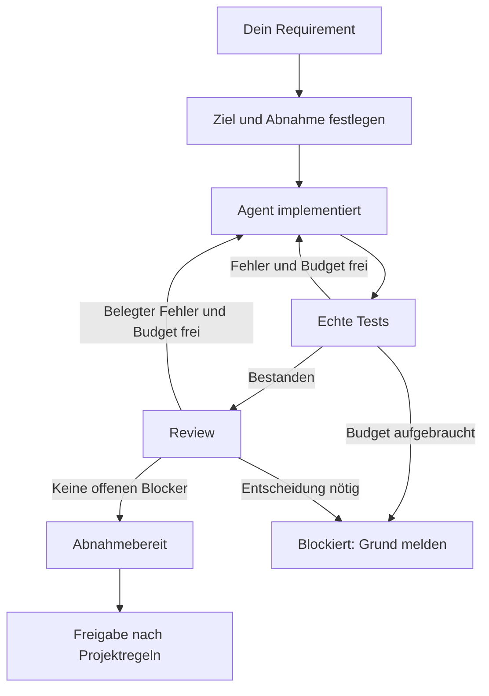

# SDD-evo

**Auftrag rein. Agent baut. Tests und Review prüfen. Änderungen machen alte Prüfergebnisse ungültig.**

[Mit deinem Agenten starten](START-HERE.md) · [Automatische Pipeline](pipeline/COORDINATOR.md) · [Runner-Befehle](RUNNER.md)

## Was bringt es?

| Problem | SDD-evo |
| --- | --- |
| Agent meldet „fertig“, ohne zu testen | Runner führt echte Tests aus |
| Code wurde nach dem Test verändert | Alter Nachweis gilt nicht mehr |
| Tests grün, Anforderung trotzdem verfehlt | Optionaler frischer Reviewer prüft Auftrag und Ergebnis |
| Agent repariert endlos | Begrenzte Test-, Review- und Reparaturversuche |
| Hintergrundaufgabe geht verloren | Pipeline speichert Status und nächsten Schritt |

## Wie läuft es?



**Abnahmebereit ≠ freigegeben ≠ deployed.** Nach einer Reparatur erneut prüfen. Ein Reviewer darf den Auftrag nicht abschwächen.

## Wie starte ich?

### Mit deinem vorhandenen Coding-Agenten

1. [Copy-paste-Auftrag öffnen](START-HERE.md).
2. In deinen Agenten einfügen, Requirement ergänzen.
3. Agent prüft das Projekt, richtet den passenden Ablauf ein und arbeitet den Auftrag ab.

[Skill-Einrichtung für Codex und Claude Code](INTEGRATION.md). Andere Hosts müssen ihre Fähigkeiten zuerst prüfen.

### Mit automatischer Aufgabensteuerung

[Pipeline einrichten](pipeline/README.md) → [Requirement übergeben und Status verfolgen](pipeline/COORDINATOR.md).

Einmalig: Repository, erlaubte Änderungen, Prüfkommandos, Worker und Limits konfigurieren. Danach speichert der Controller Aufgaben und steuert die Ausführung. **Agentenzugang und externe Benachrichtigungen sind nicht automatisch eingerichtet.**

### Ohne Modellkosten ausprobieren

Vom Repository-Hauptverzeichnis; Voraussetzungen: Linux/macOS, Python 3.10+, Git.

```sh
python3 sdd-evo/examples/run_e2e.py
```

Die Demo erzeugt einen echten Testfehler, repariert den Code und prüft erneut. Danach verändert sie den Code und weist den alten Nachweis zurück. Revieweingaben sind in dieser Demo geskriptet.

## Was ist belegt?

| Stand | Aussage |
| --- | --- |
| Lokaler Runner | Echte Testausführung und Ablehnung veralteter Nachweise |
| Pipeline und Koordinator | 140 Suite-Tests am geprüften Stand `9c1c332`; inklusive Docker-Isolationsprüfung |
| Kleine Agentenprobe | Echter Modell-Builder, separater Modell-Reviewer, echter Test; Status `pr-ready`, lokale Zustellung |
| Nutzen in realen Projekten | Noch kein kontrollierter Nachweis für weniger Fehler oder kürzere Entwicklungszeit |

Tests selbst ausführen:

```sh
python3 -m unittest discover -s sdd-evo/tests -v
python3 -m unittest discover -s sdd-evo/pipeline -v
python3 -m unittest discover -s scripts -v
```

Docker-Prüfungen brauchen das konfigurierte lokale Testimage; ohne dieses können Tests übersprungen werden. Die kleine Agentenprobe ist kein Benchmark und kein Nachweis unbeaufsichtigter Produktion.

## Grenzen

- Testadapter derzeit **Python `unittest`**; kein universeller Jest-/Pytest-Runner.
- Lokaler Runner ist **keine Sicherheitsgrenze** gegen denselben Benutzer.
- Telegram-Zustellung, dauerhafter Scheduler und echte PR-Erstellung durch den Publisher sind **nicht end-to-end nachgewiesen**.
- Tests prüfen Verhalten; ein gutes Produkt und eine richtige Anforderung brauchen zusätzliche fachliche Beurteilung.

## Details bei Bedarf

| Frage | Dokument |
| --- | --- |
| Welche Befehle und Konfiguration? | [Runner](RUNNER.md) |
| Wie prüft ein separater Reviewer? | [Critic-Protokoll](docs/CRITIQUE.md) |
| Wie unterscheiden sich OpenSpec, Spec Kit und SDD-evo? | [Vergleich](COMPARISON.md) |
| Worauf basiert das Design? | [Quellen und Evidenzgrenzen](EVIDENCE.md) |
| Warum EGM vorerst nicht übernehmen? | [EGM-Bewertung](docs/EGM-ASSESSMENT.md) |
| Welche Teile sind umfassenderer Entwurf? | [Framework](FRAMEWORK.md) · [Artefakte](ARTIFACTS.md) |

**Status: lokaler MVP, keine fertige Produktionsplattform.**
